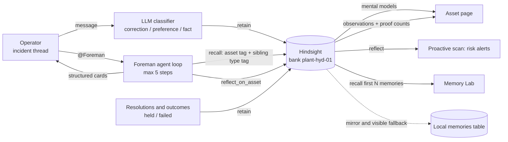

# Foreman

**An agentic plant-operations assistant that remembers every failure, every fix, and whether the fix actually held.**

Built by **NonChalant Coders**.

live:https://hackwithbangalore.lovable.app

Operators tag **@Foreman** in an incident thread. Foreman recalls similar incidents from [Hindsight](https://github.com/vectorize-io/hindsight) agent memory, forms a root-cause hypothesis, warns about fixes that already failed, proposes one-click actions (CAPA, work order, follow-up), and later asks whether the fix held. Every answer makes the next one sharper.

---

## The problem

Manufacturing and pharma plants run on tribal knowledge. When a machine faults, the fix lives in a retired technician's head, a shift log nobody reads, or a ticket closed fourteen months ago. The same deviations come back, and recurring deviations are exactly what regulators cite in inspection findings.

Ticket systems store incidents but never learn from them. A stateless chatbot gives the same generic checklist every time: check the bearings, tighten the bolts, inspect the alignment.

Foreman is built on the opposite idea: the agent's value is its memory of this specific plant.

## What Foreman does

1. **Gets tagged.** An operator writes `@Foreman Press-2 vibration is high again after the lubricant change`.
2. **Recalls.** It pulls prior incidents for that asset and for sibling machines of the same type, including the outcome of every fix.
3. **Reasons.** It states a root-cause hypothesis with confidence and cites the memories it used, by date and outcome.
4. **Refuses to repeat mistakes.** Fixes that failed before appear in a "Do NOT repeat" card and are not recommended again.
5. **Acts.** It proposes a CAPA, a work order, and a follow-up. The operator executes each with one click.
6. **Learns.** When the follow-up comes due, Foreman asks whether the fix held and retains the answer, so proven fixes are reinforced and failed ones are flagged.
7. **Warns ahead of time.** The proactive scan and the shift handover brief surface assets that match the pre-failure pattern of earlier incidents.

## Before and after memory

| Situation | Memory OFF | Memory ON |
|---|---|---|
| Press-2 vibration after a lubricant change | Generic checklist: check bearings, tighten bolts, inspect alignment | Cites earlier VIB-207 events that followed lubricant lot changes, notes that re-tightening the turret bolts failed (vibration returned after 3 days), and recommends the fix that held |
| GR-1 shaft seal seepage | "Replace the gasket" | Notes that two gasket swaps already failed (leak returned after 6 and 9 days) and that a gasket swap does not address the root cause |
| CMP-1 high discharge temperature | "Top up oil, check cooling" | Recalls that the oil top-up failed before and recommends the intake filter and aftercooler cleaning that held |

Open **Memory Lab** to see this live. It sends the same incident prompt twice, once without memory and once with memory, and a stepper (#1, #5, #12, all) replays how the answer gets more specific as memory accumulates.

## Hindsight memory: how it is used

Memory is the core of the product, not a feature. All Hindsight calls live in one file, `src/lib/foreman/memory.server.ts`, and use one memory bank for the plant: `plant-hyd-01`.

| Capability | Endpoint | Where it is used | Why |
|---|---|---|---|
| Bank setup | `PUT /banks/{bank}` | First call per server instance | Sets retain, reflect, and observation missions plus a skeptical, literal disposition so reasoning behaves like a senior reliability engineer |
| Memory Defense | `PATCH /banks/{bank}/config` | Bank setup | Redacts secrets and personal data in operator notes before they are stored (requires Memory Defense on the Hindsight plan) |
| **Retain** | `POST /memories` (async, `document_id` equals the local id) | Loading plant history, incident creation, resolutions, held/failed outcomes, operator corrections, preferences and facts, risk alerts, the agent's `retain_memory` tool | Every memory is tagged `asset:`, `type:`, `line:`, `outcome:`, and `kind:` |
| **Recall** | `POST /memories/recall` | Agent step 0 (one recall for the asset and one for sibling machines by `type:` tag), the `recall_memory` tool, shift handover, Memory Lab | Semantic, keyword, graph, and temporal retrieval |
| **Reflect** | `POST /reflect` | The `reflect_on_asset` tool, the proactive scan, and a fallback for the asset summary | Synthesized reasoning over everything known about an asset |
| **Mental models** | `GET/POST /mental-models`, `POST .../refresh` | Asset page, "What Foreman knows" | One maintained summary per asset, so the page does not run a reflect call on every load |
| **Observations** | `GET /memories/list?type=observation` | Asset page, "What the plant has learned" | Consolidated beliefs with proof counts |
| Stats | `GET /stats` | Header status badge and indexing progress | Shows Connected, Fallback, or Not configured, and tells you when async retains are fully indexed |

### Sibling-machine learning

Memories carry `type:` and `line:` tags, so a vibration pattern learned on Tablet Press-1 can inform Tablet Press-2. Evidence from a sibling asset is labelled as weaker evidence in the Memory Used panel and in the agent's answer.

### No silent fallbacks

A local `memories` table mirrors every retain. If Hindsight is unreachable, recall falls back to that mirror, but never quietly:

- every recalled memory carries a source badge (Hindsight or Local fallback)
- the thread shows an amber banner when the fallback is in use
- retain failures are recorded as `retain_failed` events and counted on the dashboard
- the header badge shows whether Hindsight is Connected, in Fallback, or Not configured

## Architecture



## The agent

The agent lives in `src/lib/foreman/agent.server.ts` and is streamed to the browser as NDJSON from `POST /api/public/agent`, so every tool call shows up live as "Foreman is recalling memory...".

- **Guaranteed recall.** Step 0 always runs recall on the server before the model answers, so memory is always consulted.
- **Tools:** `recall_memory`, `reflect_on_asset`, `get_asset_history`, `create_capa`, `create_work_order`, `schedule_followup`, `retain_memory`.
- **Propose, then execute.** Foreman proposes actions as buttons and the operator clicks to execute, unless the operator explicitly asks it to run them.
- **Robust to bad tool calls.** A malformed model response gets one repair prompt, then a plain-text fallback. The thread never crashes.
- **Models.** Groq `openai/gpt-oss-120b`, falling back to `qwen/qwen3-32b`, when `GROQ_API_KEY` is set. Otherwise the Lovable AI Gateway is used.

Structured cards in the thread: similar past incidents (with Held, Failed, and Unknown badges), root-cause hypothesis with confidence and cited memories, recommended actions, and a "Do NOT repeat" warning for fixes that failed before.

## Pages

| Page | Route | Purpose |
|---|---|---|
| Dashboard | `/` | Open incidents, assets at risk, memory stats (memories retained, recalls, fixes that held vs failed, retain failures), risk alerts, and the "Load plant history" and "Run proactive scan" controls |
| Incidents | `/incidents` and `/incidents/$id` | Chat-style thread per incident with the Memory Used panel showing every recalled memory, its date, outcome, and source |
| Assets | `/assets` and `/assets/$id` | Per-asset timeline of incidents, fixes, and outcomes, plus the mental model and Hindsight observations |
| Shift Handover | `/handover` | Generates a handover brief with risks for the next shift based on recent incidents and recalled patterns |
| Memory Lab | `/lab` | Side-by-side Memory OFF vs Memory ON with the interaction stepper |
| Sign in | `/login` | Demo passcode sign-in |

## Data

The schema and seed data are in `drizzle/migrations/0000_foreman_schema_seed.sql`.

- **Tables:** `assets`, `incidents`, `messages`, `actions`, `outcomes`, `memories`, `memory_events`, `risk_alerts`, `handovers`.
- **Seed:** 8 assets (two tablet presses, a granulator, an autoclave, a compressor, a conveyor, an HVAC unit, and a film coater) and 35 incidents with realistic fault codes, batch numbers, and technician names.
- **Deliberate patterns, so memory has something to find:**
  - Recurring turret vibration on Press-2 (fault VIB-207) after lubricant lot changes.
  - A fix that failed first: re-tightening turret bolts did not stop the vibration.
  - Repeated gasket replacements on GR-1 that did not hold.
  - Matching patterns on sibling assets of the same type.

## Getting started

### Prerequisites

- [Bun](https://bun.sh) (the repo uses `bun.lock`)
- A Supabase project (Postgres)
- A [Hindsight Cloud](https://ui.hindsight.vectorize.io) account and API key, or a self-hosted Hindsight instance

### Install and run

```bash
bun install
bun run dev
```

### Configuration

| Variable | Required | Purpose |
|---|---|---|
| `VITE_SUPABASE_URL`, `VITE_SUPABASE_PUBLISHABLE_KEY`, `VITE_SUPABASE_PROJECT_ID` | Yes | Supabase connection used by the browser client |
| `HINDSIGHT_API_KEY` | Yes | Hindsight API key (server-side only) |
| `HINDSIGHT_BASE_URL` | No | Defaults to `https://api.hindsight.vectorize.io` |
| `GROQ_API_KEY` | No | Uses Groq models when set; otherwise the Lovable AI Gateway is used |
| `LOVABLE_API_KEY` | No | Needed only for the Lovable AI Gateway fallback |
| `DEMO_PASSCODE` | No | Passcode checked by the `/login` page |

All third-party keys are read only in server code (`*.server.ts` and server functions) and are never sent to the browser.

### First run

1. Apply `drizzle/migrations/0000_foreman_schema_seed.sql` to your database.
2. Open the app and confirm the header badge says **Hindsight: Connected**.
3. On the dashboard, click **Load plant history** to retain the seeded incidents into Hindsight. Retain is asynchronous, so wait for the indexing indicator to finish.
4. Open an incident and write `@Foreman` with a question, then open **Memory Lab** and step through #1, #5, #12, and all.

## Background jobs

Two endpoints run the proactive behaviour. Both are protected by the cron secret check in `src/integrations/supabase/cron-auth.ts`, and both can be pointed at any scheduler.

| Endpoint | Suggested schedule | Job |
|---|---|---|
| `POST /api/public/cron/proactive-scan` | Every 6 hours | Finds assets whose recent incidents match earlier patterns, asks Hindsight to reflect on what preceded them, and raises risk alerts. Each alert is also retained as a `risk_alert` memory |
| `POST /api/public/cron/check-followups` | Every hour | Posts "did the fix hold?" into the thread of every incident whose follow-up is due |

The dashboard buttons **Run proactive scan** and **Check follow-ups** run the same jobs on demand.

## Project structure

```
src/
  lib/foreman/
    memory.server.ts   All Hindsight calls: retain, recall, reflect, mental models, observations, health
    agent.server.ts    Agent loop, tools, system prompt, structured cards
    llm.server.ts      Groq and gateway client with model fallback
    jobs.server.ts     Proactive scan and follow-up jobs shared by buttons and cron routes
    gate.server.ts     Demo passcode cookie signing and per-IP rate-limit helper
    api.functions.ts   Server functions used by the UI
  routes/              Dashboard, incidents, assets, handover, Memory Lab, login
  routes/api/public/   Agent stream, passcode gate, cron endpoints
  components/foreman/  App shell and memory status components
drizzle/migrations/    Schema and seed data
```

## Scripts

```bash
bun run dev      # start the dev server
bun run build    # production build
bun run test     # run the test suite (vitest)
bun run lint     # eslint
bun run format   # prettier
```

## Known limitations

- Foreman is a single-tenant demo: there are no per-user accounts, and the passcode is the only access model. Request-level enforcement of the passcode and per-IP rate limiting on the server functions and the agent route is the next hardening step.
- Operator messages are classified by an LLM before anything is retained. If the classifier fails, nothing is retained rather than guessing.
- The automated test suite currently contains a routing smoke test. Tests for the agent repair path, the Hindsight fallback, and the Memory Lab filter are planned.
- Memory Defense depends on the Hindsight plan. If the bank rejects the configuration, the app logs the error and keeps running without it.

## Learn more about Hindsight

- [Hindsight on GitHub](https://github.com/vectorize-io/hindsight)
- [Hindsight documentation](https://hindsight.vectorize.io/)
- [What is agent memory](https://vectorize.io/what-is-agent-memory)

## Authors

**NonChalant Coders**
